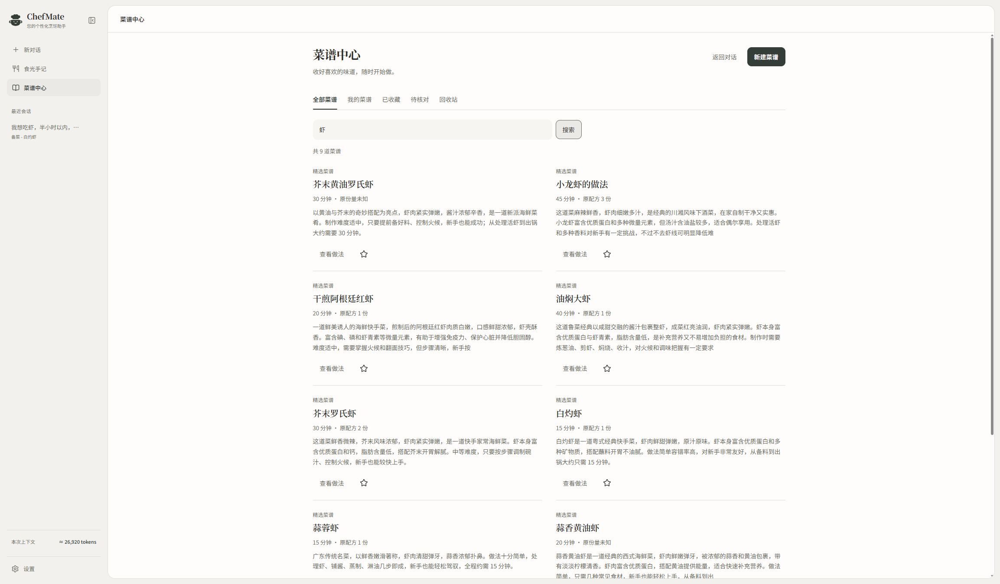
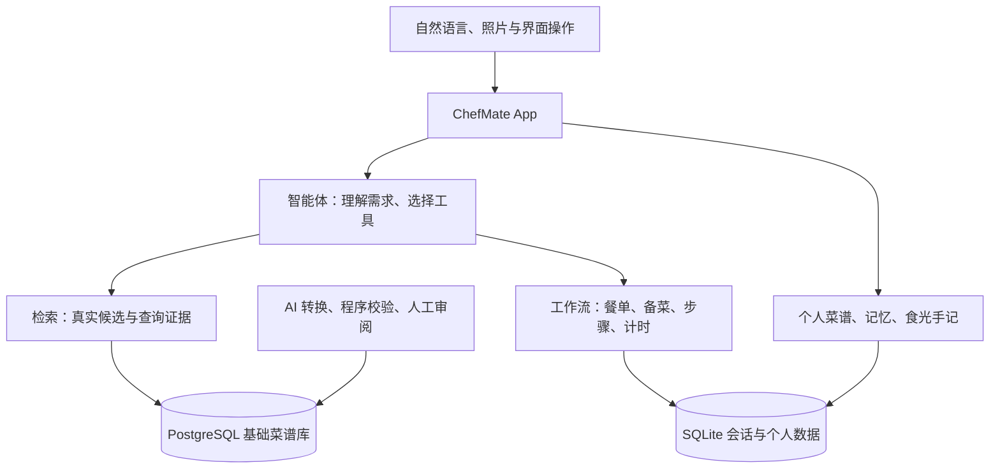

# ChefMate

**从“今晚吃什么”，到一起把这顿饭做好。**

ChefMate 是一个能查菜谱、安排一桌菜、陪你备料和做饭的 AI 厨房助手。自然语言、可操作的清单和有来源的数据在这里连成一项持续保存的任务：你负责说需求、做选择，智能体负责查资料、组织下一步，程序负责核对和保存真实进度。

[快速开始](#快速开始) · [认识项目](docs/guide/overview.md) · [智能体怎么工作](docs/guide/agent.md) · [文档中心](docs/README.md) · [开发指南](docs/guide/development.md)



## 为什么做 ChefMate

“虾怎么做”很容易得到一段回答。真正进厨房，还会遇到另一串问题：半小时够不够、五个人做四道菜各要多少、蒜是不是已经切了、刚才那口锅还剩几分钟。

ChefMate 把这些问题接到同一顿饭上。刷新页面、补充条件、切到别的对话以后，餐单、备菜确认、步骤与计时仍有明确归属。模型理解需求、灵活协作，业务规则落实在代码中。

## 可以一起做什么

- **挑一顿想吃的饭**：按食材、时间、难度、厨具和营养条件查真实菜谱，保留命中依据与未知信息。
- **安排一桌菜**：最多四道菜共享一餐，区分整餐人数和单道菜的配方份量，按可靠来源换算用量。
- **边做边聊**：逐项确认备菜、查看当前步骤、设定计时；文字或图片补充条件时，保存任务中的指导，保留原配方。
- **收好自己的菜谱**：把文字或截图整理成待核对草稿，确认后保存、收藏、再次烹饪，也可以删除和恢复。
- **留下食光手记**：照片或文字记餐先核对；单人完成餐按明确产品规则登记，多人餐先问本人吃了多少，营养保留估算与来源。
- **慢慢了解你**：用户记忆与助手总结分别保存，相关历史按需查找，当前要求优先。

这些能力由六个[系统组件](docs/design/agent-ui.md#系统组件)管理。关闭组件会同时撤去对应工具权限，已有记录仍可保留。

## 试着这样说

> “我想吃虾，半小时以内，先给我几个选择。”
>
> “今晚五个人吃四道菜，别每盘都做成五人份。”
>
> “这一步我只有平底锅，可以怎么调整？”
>
> “刚才那两道菜，我吃了三分之一滑蛋、半盘青菜。”

助手会查询、展示可核对的内容，并在需要你回答时停下来。打开清单不等于备好了，浏览步骤也不等于做完了。[跟随一次完整请求](docs/guide/overview.md)，可以看到这些交互如何组成闭环。

## 快速开始

需要 Python 3.12+、[uv](https://docs.astral.sh/uv/)、Node.js 22.12+ 和一个支持原生工具调用的模型连接。React 前端需要先构建；完整菜谱检索还需要已有的 PostgreSQL 菜谱库，本地 USDA 库用于营养查询。应用默认只监听本机。

在仓库根目录运行：

```powershell
uv sync --project apps/chefmate-playground --extra dev --python 3.12
Copy-Item apps/chefmate-playground/.env.example apps/chefmate-playground/.env
# 编辑刚创建的 .env，填写自己的模型和数据库连接。
npm --prefix apps/chefmate-playground/frontend ci
npm --prefix apps/chefmate-playground/frontend run build
uv run --project apps/chefmate-playground chefmate-playground
```

已有 `.env` 时保留原文件。打开[本地工作台](http://127.0.0.1:18765)，通过[服务状态](http://127.0.0.1:18765/api/status)检查模型与菜谱库是否就绪。页面能打开只代表 HTTP 服务已启动，缺少配置会明确显示原因。

Windows 也可运行 `apps/chefmate-playground/run.ps1`，脚本会安装锁定的前端依赖、构建页面，再启动 Python 服务。前端使用 React 19.3.1、TypeScript 7 和 Vite 8，后端将 `web/` 构建产物挂载到 `/static`。

新环境的数据准备、只读检查和隔离运行方式见[开发指南](docs/guide/development.md)。启动工作台不会创建数据库、导入菜谱或下载 USDA 数据。

## 从 App 看架构



| 从哪里读代码 | 负责什么 |
| --- | --- |
| [核心 App](apps/chefmate-playground/README.md) | 聊天、厨房界面、HTTP/SSE、会话与个人数据 |
| [智能体](packages/chefmate-agent/README.md) | 标准 Agent 执行、预算、证据校验、上下文和扩展工具 |
| [工作流](packages/chefmate-workflow/README.md) | 可验证的厨房任务和界面协议 |
| [检索](packages/chefmate-retrieval/README.md) | 食材候选、多约束筛选、快照和来源 |
| [数据能力](packages/README.md) | 共享契约、USDA、菜谱处理与 PostgreSQL 存储 |
| [清洗工具](data_cleaning/README.md) | 把原始菜谱变成可发布的数据 |

## 值得了解的技术选择

**让模型选择，让程序核对。** LangChain 标准 Agent 承担模型与工具的循环，ChefMate 在调用边界检查参数、来源、预算和权限；阶段门槛与份量计算由领域服务执行。[智能体详解](docs/guide/agent.md)

**把一次做饭当成有状态的任务。** 数据版本确认引用是否仍有效，任务冻结配方避免源库更新改变手头这顿饭，修订号与幂等标识保护用户刚做的操作。[设计决策](docs/design/decisions.md)

**让数字能追问来源。** AI 提取结构、选择真实食材候选，程序结合 USDA 数据计算营养；未知值、估算值与已确认来源分别保留。[数据的一生](docs/guide/data.md)

**让交互结果成为下一轮的事实。** 模型展示白名单组件，界面操作先保存，下一轮从服务端重建短快照，无需反复发送完整页面对象。[界面与任务架构](docs/design/agent-ui.md)

## 开发与验证

```powershell
apps/chefmate-playground/.venv/Scripts/python.exe -m pytest apps/chefmate-playground/tests packages -q -p no:cacheprovider --basetemp=apps/chefmate-playground/.runtime/pytest
npm --prefix apps/chefmate-playground/frontend test
npm --prefix apps/chefmate-playground/frontend run build
apps/chefmate-playground/.venv/Scripts/python.exe scripts/check_docs.py
```

数据库集成测试需要显式配置 `CHEFMATE_TEST_DSN`，在随机测试 schema 中执行。清洗工具有自己的依赖环境。完整检查命令、测试范围与浏览器验收见[开发指南](docs/guide/development.md)及[工程记录](docs/engineering/README.md)。离线模型替身用于验证边界，真实模型效果另有记录。

## 继续了解

- 初次接触项目：[从一顿饭开始](docs/guide/overview.md) → [智能体的核心技术](docs/guide/agent.md) → [数据的一生](docs/guide/data.md)。
- 准备参与开发：[模块地图与开发指南](docs/guide/development.md) → [设计规范](docs/design/README.md) → [接口参考](docs/reference/README.md)。
- 想追溯演进：[工程档案](docs/engineering/README.md)保留计划、真实验收和限制，不把旧结论当作当前状态。

当前实现是本地厨房工作台。账号体系、语音、自训练视觉模型与经过对照实验验证的推荐算法仍有独立扩展空间；图片理解来自配置的外部多模态模型。文档中的设计收益以代码机制和验收范围为依据，不等同于量化效果承诺。

README 的信息组织参考 [Gemini CLI](https://github.com/google-gemini/gemini-cli)：先认识产品、快速运行，再深入功能和文档。字体与图标的来源和许可证保留在各自资源目录。
