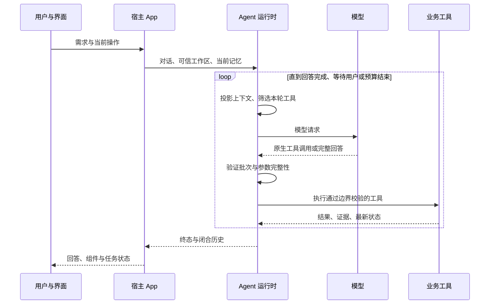
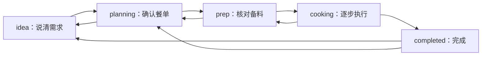

# 智能体如何可靠地帮忙

想象厨房里有一位会听需求、查资料、安排下一步的搭档。
ChefMate 给这位搭档一套能调用的工具，也把菜谱来源、任务状态、权限和保存条件交给程序维护。
这一章沿着“我想吃虾”解释模型和工程规则怎样合作。
下文对话、菜名和 ID 都是**合成示例**，用于说明协议，不是某次模型运行的逐字回放。

## 先看真正的入口

[`ChefMateAgent`](../../packages/chefmate-agent/src/chefmate_agent/core.py) 用 LangChain 的 `create_agent` 组装模型、工具和 `ChefMateMiddleware`。
标准运行时负责模型与工具之间的循环，ChefMate 在 middleware 和业务工具上增加领域约束。
这种分工对应官方的 [Agent](https://docs.langchain.com/oss/python/langchain/agents)、[自定义 middleware](https://docs.langchain.com/oss/python/langchain/middleware/custom) 与 [Tools](https://docs.langchain.com/oss/python/langchain/tools) 扩展方式。



“观察结果，再决定下一步”的思路可对照 [ReAct 论文](https://arxiv.org/abs/2210.03629)。
本项目使用标准工具调用循环实现业务协作；引用这篇论文用于解释思路，不代表复现论文实验或取得其评测结果。

## 第一步：让“虾”落到真实候选

模型收到“想吃虾，别太费事”，可以调用 `find_ingredients` 获取当前库里确实存在的身份、别名和例子。
假设返回虾仁与带壳虾，模型根据需求选择候选，再调用 `search_recipes`。
`get_recipe` 读取选中的真实菜谱，`get_search_options` 提供当前可用的厨具、标签和筛选项。
四个查询工具都通过只读检索服务访问数据。[检索工具实现](../../packages/chefmate-retrieval/src/chefmate_retrieval/service.py)

```text
用户：我想吃虾，最多半小时。
find_ingredients → 返回真实候选与 snapshot
search_recipes → 用候选 selector、明确时间限制和相同 snapshot 查询
get_recipe → 用结果中的 recipe_id 读取做法
select_recipes → 用已检索证据建立本次餐单
```

这串操作的关键是引用证据。
模型不能直接拿一个像真的 `recipe_id` 就读任意菜谱；工具会检查引用是否出现在已有结果中，以及快照是否对应。
来源变化会得到 `snapshot_required` 或 `snapshot_changed` 等结果，下一步应重新读取真实证据。[引用校验](../../packages/chefmate-agent/src/chefmate_agent/evidence.py) · [检索回归](../../packages/chefmate-retrieval/tests/test_retrieval.py)

## 第二步：把聊天接到可执行任务

厨房任务使用明确阶段，用户操作与模型工具最终遵守同一份工作流规则。



箭头只表示允许考虑的方向，每次转换仍要核对前置条件。
例如未备齐且未确认跳过的项目会阻止进入烹饪，未完成的步骤会阻止把整餐标为完成。
返回结果含 `current_actions`、`allowed_transitions` 与 `blockers`，模型和界面都能知道“还差什么”。[阶段与动作规则](../../packages/chefmate-workflow/src/chefmate_workflow/kitchen.py)

工具可见性也跟随阶段、组件启用状态和当前能力变化。
`_model_tools` 控制本轮给模型的工具，执行工具时再检查权限和业务条件。
注册的协议仍能校验已有历史，当前调用则只开放适用能力。[工具执行边界](../../packages/chefmate-agent/src/chefmate_agent/tool_execution.py) · [阶段绑定测试](../../packages/chefmate-agent/tests/test_runner_extensions.py)

## 三种“版本”各管一件事

| 标识 | 回答的问题 | 一个例子 |
|---|---|---|
| 数据集 `snapshot` | 这次引用来自哪批菜谱？ | 同名数据版本重新导入也会有新的导入时刻 |
| 工作区 `revision` | 基于哪个业务状态修改？ | 用户已经改人数，旧表单不能覆盖新餐单 |
| `presentation_revision` | 当前组件展示到哪个版本？ | 替换卡片与真正改变任务分别记录 |

操作还有独立 `action_id` 和内容指纹。
相同操作重试会返回已有结果；同一个 ID 携带不同内容会冲突。
保存时先在当前事务中核对版本、执行命令、验证完整工作区，成功后才替换持久数据。[原子命令边界](../../packages/chefmate-workflow/src/chefmate_workflow/service.py)

选定的菜谱会冻结到任务中，保留食材、做法、营养及必要来源。
因此“源菜谱后来更新”和“这顿饭当时按什么做”能够分别表达。
已有针对过期版本、重复动作、来源变化与并发人工修改的[工作流回归](../../packages/chefmate-workflow/tests/test_workflow.py)。

## 原生调用和受控组件怎样配合

模型通过原生工具参数表达意图，参数受 Pydantic schema、大小、字段和业务约束检查。
供应商适配层还核对原始流式工具参数，遇到不完整或无法对应的批次会报告错误。
把 `<tool_call>` 一类协议标记写进普通回答，也会被识别为协议泄漏。[供应商完整性处理](../../packages/chefmate-agent/src/chefmate_agent/provider.py) · [流式参数测试](../../packages/chefmate-agent/tests/test_provider_stream.py)

界面组件由服务端定义结构，前端只渲染受支持的组件类型。
模型可以申请显示菜谱候选、备料清单、步骤、提问等界面，实际内容经过应用协议校验。
例如 `ask_user` 保存待回答问题后结束本轮，用户回答再形成真实动作继续任务。[界面协议设计](../design/agent-ui.md)

个人菜谱也有明确的“整理、修改、确认保存”过程。`create_recipe_draft` 整理用户提供的原文或图片，`get_recipe_draft` 读取真实草稿，`revise_recipe_draft` 按已读取的 ID 和版本修改同一份记录。
对话审核卡展示服务端当前内容；修改入口只填写输入框，用户发送后才交给助手处理。份数、时间、难度和精确克重需要来源依据，不能按菜名或步骤自行补齐。[草稿合同](../../apps/chefmate-playground/src/chefmate_playground/recipe_drafts.py) · [审核卡](../../apps/chefmate-playground/frontend/src/components/RecipeReview.tsx)

需要由助手发起保存确认时，`request_recipe_publication` 创建与草稿 ID、版本和问题绑定的回执；`confirm_recipe_publication` 再核对真实用户答案后保存，选择继续修改则保留草稿。
用户也可直接点击审核卡的保存按钮；有待答问题或会话状态尚未同步时，该入口隐藏或禁用。版本冲突要求重新核对，不会自动重试发布。[发布确认](../../apps/chefmate-playground/src/chefmate_playground/recipe_publication.py)

涉及写入、等待或展示的依赖操作要求逐次调用。
“改人数”和“按新人数确定下一步”需要先拿到修改成功与最新版本，避免模型在一个批次里假定前一步已经生效。
独立只读工具仍可按照运行时支持的方式调用。[批次策略](../../packages/chefmate-agent/src/chefmate_agent/tool_execution.py)

## 上下文：带上当前厨房，留住完整依据

应用从服务端任务重建 `ui_context`，客户端上传的菜谱或表单 JSON 不直接成为权威状态。
模型看到的是适合推理的短快照，包括最新份量、当前步骤、可用动作和最近操作。
后续请求可用增量表达组件变化与移除，减少重复信息，同时保留备料用量等操作所需事实。[历史与快照](../../packages/chefmate-agent/src/chefmate_agent/history.py)

历史预算按完整的人类轮次裁剪，避免把“助手发起工具调用”和“工具返回结果”拆散。
已完成的模型轮次才提交闭合对话历史；失败的生成批次不会成为半截历史。
成功业务工具的持久修改有独立边界，失败回答仍需根据当前工作区解释已经发生的事情。[单轮入口](../../packages/chefmate-agent/src/chefmate_agent/core.py)

长期记忆分为用户自己写的偏好与助手维护的摘要，助手不能覆盖用户原文。
当前记忆按预算临时附加到最新人类消息，避免在持久对话里不断叠加旧版本；需要更早经历时按需检索个人历史。[记忆仓库](../../apps/chefmate-playground/src/chefmate_playground/memory.py) · [记忆权限测试](../../packages/chefmate-agent/tests/test_memory_permissions.py)

图片在历史里保存引用元数据，推理时才加载为模型原生图片内容。
是否支持图片由配置声明，图片数量和历史一起计入预算。
缺图、超限或未开启图片能力时会明确返回错误或说明限制。[图片回归](../../packages/chefmate-agent/tests/test_runner_extensions.py)

## Skills：先知道能做什么，用到时再读细节

系统提示先放启用技能的名称和简介，模型需要具体流程时调用 `load_skill`。
当前七个系统组件——选菜与餐单、备菜与准备、烹饪引导、个人菜谱、应用偏好、长期记忆和饮食记录——分别有应用指引。
技能加载器只读取显式允许目录中的 `SKILL.md`，检查路径、内容变化和读取预算；应用层再把技能与组件工具绑定。[加载器](../../packages/chefmate-agent/src/chefmate_agent/skills.py) · [组件注册](../../apps/chefmate-playground/src/chefmate_playground/components.py)

例如“历史里只提到电磁炉”不能自动推成“现在只有这一种厨具”。
餐单指引要求明确菜名优先按名查询，历史偏好谨慎转成约束，确需过滤时先读真实枚举。
这类领域细节进入按需指引，让核心协议保持稳定，业务经验可以单独维护。[餐单技能](../../apps/chefmate-playground/skills/meal-planning/SKILL.md) · [相关工程记录](../engineering/records/2026-10-22-automatic-intake-and-typography.md)

“应用偏好”组件通过 `get_app_preferences` 读取普通偏好及其版本，再以 `update_app_preferences` 提交用户明确要求修改的字段。
白名单仅包含主题、浅深配色、字体、密度、内联展开数量、估算标识与推荐回复开关及数量；模型配置、密钥、组件开关、开发者设置和运行预算不在工具权限内。
陌生字段和过期版本会被拒绝，省略字段保持原值。页面重新读取服务端偏好应用变化，打开历史工具结果不会把外观退回旧值。[偏好服务与工具](../../apps/chefmate-playground/src/chefmate_playground/ui_preferences.py) · [前端同步](../../apps/chefmate-playground/frontend/src/features/preferences/client.ts)

## 失败时怎样收尾

每轮有模型次数、工具次数、超时和上下文预算。
失败策略为错误生成可修正的字段提示，并识别相同参数、相同失败状态的重复调用。
持续没有进展时会关闭相应分支或进入只回答的收尾阶段，保留真实失败结果。[失败策略](../../packages/chefmate-agent/src/chefmate_agent/failure_policy.py) · [运行保护测试](../../packages/chefmate-agent/tests/test_harness.py)

调试事件记录实际请求投影、工具目录、参数完整性诊断与用量。
可观测性帮助回答“模型这一轮看到了什么、能调用什么、为什么没执行”，敏感字段按规则脱敏。
实际缓存和 token 用量以服务端可得指标为准，缺失指标保留未知。[调试记录](../../packages/chefmate-agent/src/chefmate_agent/debug.py) · [用量记录](../../packages/chefmate-agent/src/chefmate_agent/telemetry.py)

普通界面只在助手回复位置显示简短活动状态，错误、停止与重试保留。开启开发者模式后，侧栏增加上下文分类估算彩条，回复可展开工具执行时间线，右侧诊断提供中文工具目录、组件依赖状态，以及按会话轮次和模型请求选择的时间线或树视图。
系统提示词、用户输入、助手消息、工具调用和结果分别标识，参数与结果默认显示概要，完整内容按需展开；报告用量、部分已知统计和请求大小粗估分别说明。
版本和当前时间水印也只在开发者模式显示；未留存的请求明确标为缺失，不重建历史，也不展示隐藏推理正文。[开发者诊断](../../apps/chefmate-playground/frontend/src/components/developer/Diagnostics.tsx)

## 如何判断这些设计是否真的有效

先看确定行为：陌生 ID 是否拒绝、过期操作是否冲突、失败批次是否留下半截历史、关闭组件后工具是否确实停用。
再看完整链路：真实模型能否从检索走到餐单、备菜、烹饪和本人份额登记，界面与存储是否一致。
单元测试、真实模型验收和推荐质量评估回答的是不同问题；项目的历史验收见[工程记录](../engineering/records/)，当前检查见对应最新记录。

继续阅读：[数据如何走到餐桌](data.md) · [整体流程](overview.md) · [智能体详细参考](../reference/agent.md)
