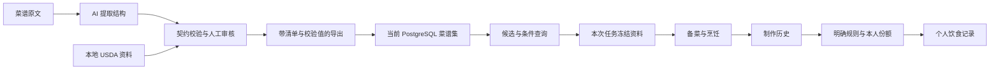

# 数据如何走到餐桌

一句“番茄炒蛋”很容易说出口，程序却需要知道食材身份、用量、人数、步骤、来源与未知项。
ChefMate 的数据工作就是把这些关系接起来，让检索、厨房执行和个人记录使用能够核对的资料。
本文所有菜名、ID 与算式中的数值均为**合成示例**；具体字段与行为对应源码和测试。

## 先分清两条入口

| 入口 | 怎样产生资料 | 怎样进入后续使用 |
|---|---|---|
| 菜谱资料库 | 清洗平台提取、标准化、营养补充、人工审核 | 导出校验后导入 PostgreSQL，供确定查询 |
| 用户个人资料 | 对话中的菜谱草稿、照片或文字记餐、实际烹饪任务 | 各自核对、确认或触发明确完成规则后保存 |

两条入口共享数据意识：原文、标准字段、估算和用户确认需要分别表达。
库中已审核菜谱、个人刚生成的草稿和一次已完成烹饪，各自处于不同的生命周期。
[清洗流程](../../data_cleaning/models/workflow.py) · [个人菜谱](../../apps/chefmate-playground/src/chefmate_playground/cookbook.py) · [饮食记录](../../apps/chefmate-playground/src/chefmate_playground/meal_logging.py)



这里的 AI 负责建议结构、匹配或估算；契约验证、审核状态和数值计算由对应程序环节完成。
通用处理能力在 `chefmate-recipe-processing`，清洗平台承担处理任务与审核界面。
AI 接口可以注入同步或异步实现，处理包无需依赖这套应用界面。[处理 API](../../packages/chefmate-recipe-processing/src/chefmate_recipe_processing/api.py) · [处理回归](../../packages/chefmate-recipe-processing/tests/test_processing.py)

## “西红柿”和“番茄”为什么要多存几个字段

一个食材条目至少有三层含义：原文怎么写、标准身份是什么、它在这道菜里怎么用。

| 字段或关系 | 合成示例 | 存在的理由 |
|---|---|---|
| 原文 | “西红柿两个，切块” | 保留用量、形态和文字依据 |
| `ingredient_id` | `tomato` | 跨菜谱引用同一个标准身份 |
| `canonical_name` / 别名 | “番茄” / “西红柿” | 让查询词和标准名称能够关联 |
| 本次出现的用量 | `raw_amount: "2"`、`raw_unit: "个"` | 身份相同的食材，在不同菜谱中有不同用量 |
| `grams` 与估算标记 | 克重未知，或带估算来源的换算值 | 区分已知克重与推断值 |
| USDA/FDC 引用 | 某个匹配食物的营养资料 | 给营养计算提供可定位的参考 |

原始个数不能直接变成精确克重；两只番茄的大小需要更多信息。
同一食材 ID 在不同菜谱里的原文和用量也不会合并丢失。[共享契约](../../packages/chefmate-contracts/src/chefmate_contracts/schemas.py) · [出现记录回归](../../packages/chefmate-storage/tests/test_importer.py)

## 营养参考关系为什么不能充当同义词

本地食品库读取 USDA FoodData Central 的选定资料集，提供搜索、营养和来源信息。
数据类型与字段含义可对照 [USDA 官方数据说明](https://fdc.nal.usda.gov/data-documentation/)，本项目使用的数据集配置见 [`datasets.py`](../../packages/chefmate-food-data/src/chefmate_food_data/datasets.py)。
当前选用 Foundation Foods 与 SR Legacy：前者提供样品及其营养分析资料，后者汇集历史标准参考数据，具体发布版本由代码配置固定。
数据下载与维护显式进行，运行时查询读取本地资料。[本地食品库](../../packages/chefmate-food-data/src/chefmate_food_data/fooddata.py)

假设“虾仁”和“混合馅”都借用了同一份虾类营养资料，这只能解释它们怎样计算营养。
它不能证明混合馅是虾仁的同义词，也不能证明某份混合馅一定含虾。
因此候选结果保留 `match_evidence`、`matched_by` 与 `reference_only`，把别名匹配和共享参考分开呈现。[检索证据](../../packages/chefmate-retrieval/src/chefmate_retrieval/service.py)

如果库里没有可靠的主料、必选或可选字段，系统会保留原文和 warnings 给用户核对。
“标签里没有记录过敏原”同样只说明未记录，不能据此推断实际不存在。
这些界限写进工具结果与[检索测试](../../packages/chefmate-retrieval/tests/test_retrieval.py)。

## 查询：一组里任选，几组都要有

自然语言“虾配鸡蛋”可能对应多种食材身份。
`ingredient_groups` 允许在一个概念内部使用 OR，在多个概念之间使用 AND。

```text
虾这一组：虾仁 OR 去皮虾
鸡蛋这一组：鸡蛋
查询意思：(虾仁 OR 去皮虾) AND 鸡蛋
```

实际 selector 必须来自真实候选；示例中的两种虾只是解释分组语义。
查询还支持明确排除、耗时、厨具、营养范围、排序和分页。
无效的身份或枚举会返回错误，查询不会悄悄丢掉条件变成全库推荐。[查询模型](../../packages/chefmate-retrieval/src/chefmate_retrieval/models.py) · [SQL 条件](../../packages/chefmate-storage/src/chefmate_storage/queries.py)

这里使用明确候选、字段匹配和关系查询，结果可以附上匹配食材与来源。
候选排序中的权重是可检查的工程规则；推荐质量仍需要额外评测，不能由“能返回结果”直接推出效果提升。

## 一批数据怎样安全地换成下一批

清洗导出包含菜谱、映射与 manifest，导入器先验证格式、批准状态、文件路径、哈希、关系和营养一致性。
校验成功后，存储包在一个事务中替换自己管理的当前数据集。
运行库保存选定的关系字段与必要原文，不把清洗数据库的完整历史和所有原始大对象一起搬进来。[导入验证](../../packages/chefmate-storage/src/chefmate_storage/importer.py) · [数据替换](../../packages/chefmate-storage/src/chefmate_storage/database.py)

一次检索使用只读 Repeatable Read 事务，使元数据、候选和结果在该读取范围中看到一致数据。
存储包还使用约定的事务级共享/独占 advisory lock 协调自己的读取与替换入口。
这些锁的协调作用要求访问方遵守同一协议；数据库事务的一般语义见 [PostgreSQL 官方隔离级别说明](https://www.postgresql.org/docs/18/transaction-iso.html)。

一次请求结束后，下一次请求可能看到新数据。
所以返回值还带 `data_version` 与 `imported_at` 组成的快照，后续工具必须核对它。
同名版本重新导入也会改变导入时刻，旧引用会被拒绝。[快照拒绝测试](../../packages/chefmate-retrieval/tests/test_retrieval.py)

本次选菜进一步冻结必要资料，解决的是“这顿饭继续照哪份做法执行”。
数据库读取快照、跨请求引用校验和任务冻结分别覆盖三个时间范围，合起来才形成完整的来源链。[冻结规则](../../packages/chefmate-workflow/src/chefmate_workflow/kitchen.py)

## 未知值留空，估算一路带标记

营养计算基本关系为：`某食材贡献 = 每 100g 营养 × 使用克重 ÷ 100`。
每个营养指标分别检查覆盖情况，克重或参考值缺失时保留未知；“没有查到钠”不会变成“钠为 0”。
AI 补充值放在 `__ai_estimate__` 等显式估算结构中，并通过文档指纹验证适用性；编辑文档后旧估算不能直接沿用。[营养计算](../../packages/chefmate-recipe-processing/src/chefmate_recipe_processing/nutrition.py) · [估算边界](../../packages/chefmate-recipe-processing/src/chefmate_recipe_processing/estimation.py)

例如一道合成菜谱只知道鸡蛋的蛋白质，不知道酱料的钠，界面就保留对应未知项。
总量、每份值和估算字段携带各自的标记，查询也能明确是否允许使用估算值。
这样用户可以看懂数据依据，后续筛选也不会把不完整值装作精确值。[未知与估算回归](../../packages/chefmate-storage/tests/test_importer.py)

## 做几份和吃了多少分别计算

先记住三个量：**整餐几个人吃、每道菜做几份、本人吃了整盘的多少**。
它们分别服务于计划、用量换算和个人记录。

| 概念 | 合成示例 | 应用怎样使用 |
|---|---|---|
| `meal_diners` | 5 人一起吃 | 描述整餐人数 |
| 每道 `target_servings` | 4 道共享菜默认各 2.5 份 | 给出可覆盖的备菜目标 |
| 本人 `fraction` | 滑蛋吃了 1/4，青菜吃了 1/2 | 分别计算本人在每道菜中的摄入 |

共享模式按菜数提供默认系数：1、2、3、4 道分别使用 1、0.75、0.6、0.5，再乘整餐人数。
因此“5 人 4 菜各 2.5 份”是明确的默认规划规则，用户可以逐菜覆盖，也可以选逐菜按人数的模式。
它没有声称给出经过营养学实验验证的最佳菜量。[规划规则](../../packages/chefmate-workflow/src/chefmate_workflow/kitchen.py) · [多人菜量测试](../../packages/chefmate-workflow/tests/test_workflow.py)

菜谱原人数可靠时，可缩放食材按目标/原人数换算；不可缩放食材保留原值。
原人数未知时，任务可以保存目标，实际用量仍保留来源限制。
这比把“适量盐”“两个鸡蛋”和“100g 虾仁”全部机械乘倍数更能表达原文含义。[份量投影](../../packages/chefmate-workflow/src/chefmate_workflow/projection.py)

## 完成之后，个人营养怎样登记

饮食记录组件启用且发生真实完成事件时，已知单人餐按本次冻结配方整份自动登记，可更正比例。
多人餐和人数未知的餐只先保存制作历史，个人登记处于 `awaiting_portions`，需要本人逐菜说明。
读取历史、看统计或刷新页面不会触发补登记；关闭组件也会关闭对应自动登记。[登记源码](../../apps/chefmate-playground/src/chefmate_playground/cooked_intake.py) · [完整回归](../../apps/chefmate-playground/tests/test_cooked_intake.py)

假设冻结资料中滑蛋整盘 400 kcal、青菜整盘 120 kcal，用户明确说“我吃了四分之一滑蛋、半盘青菜”。
后端计算 `400 × 1/4 + 120 × 1/2 = 160 kcal`，仍标为基于配方的估算。
模型提交的是每道菜的真实 ID、比例和本人原话；卡路里由服务端计算，未知指标继续为空。

写入前还要在本轮读取本餐来源版本与登记版本，逐道核对原话和比例。
疑问、计划、假设、引用或他人份额不能当作本人的实际食用依据；只报“吃了一碗”而无法对应整盘比例时，需要继续澄清。
同一餐更正使用稳定身份更新原记录，避免把一次修改算成第二顿饭。[逐菜依据与版本校验](../../apps/chefmate-playground/src/chefmate_playground/cooked_intake.py)

这些规则把“做了这一桌菜”和“我实际吃了这些”连接起来，同时保留各自的证据。
真实端到端验收案例见[完成餐食登记工程记录](../engineering/records/2026-10-22-automatic-intake-and-typography.md)，其中数据只代表该次验收。

继续阅读：[整体流程](overview.md) · [智能体边界](agent.md) · [菜谱字段参考](../reference/recipe-fields.md) · [存储参考](../reference/storage.md)
