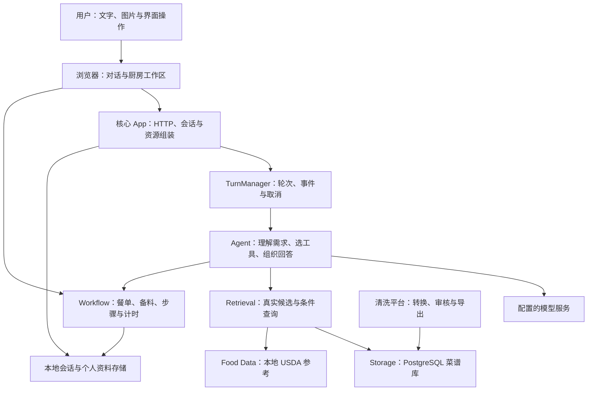

# 从一顿饭认识 ChefMate

ChefMate 把“今天吃什么”接到“这一餐做完了”：理解食材与限制，查找有来源的菜谱，安排菜量，逐项备菜，跟随步骤，最后留下制作与个人饮食记录。
聊天负责让需求自然地说出来，厨房工作区负责让事情真的推进。

读完这篇，可以知道应用怎样工作、各模块为何存在，以及从哪里继续读代码。
本文的对话与数值案例均为**合成示例**；能力说明对应仓库实现，实际结果取决于当前菜谱数据和模型配置。

## 先打开核心 App

主要入口是 [`apps/chefmate-playground`](../../apps/chefmate-playground/README.md)。
它虽然保留了 Playground 这个工程名，已经承担聊天、厨房任务、个人菜谱、食光手记、饮食记录和设置的完整应用入口。
后端用 `create_app()` 组装依赖，HTTP 路由按会话、工作区、个人资料、菜谱库和系统能力分开。
前端使用 React 19.3.1、TypeScript 7 和 Vite 8，界面组件通过独立状态服务处理流式对话、草稿和厨房交互。[前端入口](../../apps/chefmate-playground/frontend/src/App.tsx)
业务规则放在应用服务与独立 Python 包中，入口文件负责把它们接起来。[应用组装源码](../../apps/chefmate-playground/src/chefmate_playground/app.py) · [路由目录](../../apps/chefmate-playground/src/chefmate_playground/routes/)

可以把界面理解为两位搭档：

| 所在位置 | 解决的问题 | 典型动作 |
|---|---|---|
| 对话区 | 把模糊需求说清楚 | “两个人，想吃虾，半小时内做好” |
| 厨房工作区 | 把已确认的任务推进 | 选菜、调整份量、勾备料、确认步骤、开计时 |
| 菜谱中心 | 留住可重复使用的做法 | 从文字或图片整理草稿，核对后保存 |
| 食光手记与饮食记录 | 分清做过什么、本人吃了什么 | 看制作历史、确认本人逐菜份额、修正记录 |
| 长期记忆与设置 | 让上下文和能力可管理 | 自写偏好、查看助手摘要、启停系统组件 |

这些能力由[组件清单](../../apps/chefmate-playground/src/chefmate_playground/components.py)绑定指引、工具、页面与依赖。
关闭一个组件会同时影响对应工具的可执行性；配置并非只改变界面上的一个开关。
当前 0.2.1 的七个系统组件是选菜与餐单、备菜与准备、烹饪引导、个人菜谱、应用偏好、长期记忆和饮食记录。
其中“应用偏好”让用户通过对话调整主题、配色、字体、显示密度和推荐回复等普通设置；模型连接、密钥、开发者选项和运行参数仍由设置界面管理。[普通偏好边界](../../apps/chefmate-playground/src/chefmate_playground/ui_preferences.py)

## 跟着小林做一顿饭

下面是一条产品流程，展示系统在每一步怎样分工。
示例中的菜名代表“假设当前库能找到这些菜”，并不承诺任意数据库都有相同结果。

### 1. “冰箱有虾和鸡蛋，两个人吃”

智能体先理解需求，需要查食材时调用 `find_ingredients`，从真实候选中得到可引用的身份。
需要限制口味、厨具或做法时，可以先读取当前可用选项。
服务端再按明确条件执行 `search_recipes`；模型负责选择和解释，查询由确定的程序执行。
查不到结果时会返回真实的空结果，让用户决定怎样调整条件。[检索实现](../../packages/chefmate-retrieval/src/chefmate_retrieval/service.py)

这里有个容易忽略的小细节：“虾仁”和“鲜虾仁”可能通过别名关联，具有同一营养参考的“混合馅”却未必就是虾仁。
检索会保留匹配证据与 `reference_only` 提示。
想了解“同义词”和“参考关系”的差别，可以接着读[数据如何走到餐桌](data.md)。

### 2. “就选滑蛋和青菜吧”

选菜工具只接受当前任务已知的菜谱，或服务端认可的检索引用。
确认餐单后，工作流保存本次使用的菜谱和来源快照。
这份“厨房里的打印件”让后续备料、步骤和营养都能沿用同一份依据；来源库重新导入后，正在做的菜仍有稳定的原件。[冻结与餐单规则](../../packages/chefmate-workflow/src/chefmate_workflow/kitchen.py)

两个人吃两道菜时，“整餐人数”和“每道菜做几份”分别保存。
应用提供共享餐单的默认菜量规则，也允许逐菜调整。
这个默认值是可修改的产品启发式，具体计算见[数据篇的份量案例](data.md#做几份和吃了多少分别计算)。

### 3. “虾仁备好了，青菜还没洗”

准备清单保留菜品和食材身份，用户逐项标记备齐，或明确确认跳过。
仍有待确认项时，进入烹饪阶段会得到可解释的阻碍原因。
模型和界面都通过同一份工作流规则操作，避免出现聊天里说能开始、按钮里却还是另一套规则的情况。[阶段规则](../../packages/chefmate-workflow/src/chefmate_workflow/kitchen.py) · [行为测试](../../packages/chefmate-workflow/tests/test_workflow.py)

### 4. “锅里现在这样，可以继续了吗？”

开启图片能力的模型可以接收本轮照片，并结合当前步骤给出说明。
`update_cooking_guidance` 保存针对这次任务的补充指引；原始做法、用量与用户确认过的进度仍各自保留。
计时器的截止时间存放在服务端，页面根据实际时间刷新。
响铃表示时间到了，步骤是否完成仍由用户确认。[图片与上下文处理](../../packages/chefmate-agent/src/chefmate_agent/runner.py) · [计时回归](../../apps/chefmate-playground/tests/test_cooking_timers.py)

### 5. “做好了，我吃了半盘滑蛋、三分之一青菜”

实际完成会保存制作历史。
饮食记录组件启用时，**单人餐**按明确产品规则把本次冻结配方整份自动登记，并标为估算，可继续更正。
**多人餐或人数未知**时，先等待本人逐菜份额，系统不会从“有两个人”推断“每道都吃了一半”。
模型读取本餐状态后提交本人原话和逐菜比例，后端用冻结资料计算个人营养。[完成餐食登记](../../apps/chefmate-playground/src/chefmate_playground/cooked_intake.py)

如果小林更正“滑蛋其实只吃了四分之一”，系统更新同一条个人记录。
重新打开历史、刷新页面、重复提交已有操作，都有相应规则防止重复入账。
外部照片或文字记餐则走草稿核对流程，不能套用“单人完成烹饪”的自动登记规则。[登记回归](../../apps/chefmate-playground/tests/test_cooked_intake.py) · [普通记餐流程](../../apps/chefmate-playground/tests/test_food_log_confirmation.py)

## 把自己的做法留下来

用户提供文字或图片菜谱后，助手可以整理带来源的个人菜谱草稿，在对话内展示审核卡。
卡片重新读取当前版本，展示名称、份数、耗时、难度、原始食材用量、步骤和来源依据；原文没有明确的时间、难度与份数保留未知。
“告诉助手怎么改”只把带草稿 ID 的修改起始文字放进输入框，用户发送后，助手读取并修改同一份草稿。

核对后可以在卡片明确确认保存，也可以完成助手发出的保存问答；已有待答确认时，卡片不再提供第二个保存入口。
保存核对草稿版本，冲突后保留当前显示内容、要求重新读取；成功后显示已保存，并可继续聊这道菜怎么做。[对话审核卡](../../apps/chefmate-playground/frontend/src/components/RecipeReview.tsx) · [草稿与发布工具](../../apps/chefmate-playground/src/chefmate_playground/recipe_tools.py)

## 一张图看清整体

图中的箭头表示主要业务关系；实际调用通过应用注入的服务与工具连接。
清洗平台先生成经过校验的导出，存储包再执行导入，运行时查询不会触发清洗或自动下载数据。

## 为什么拆成这些模块

| 模块 | 掌握什么 | 让什么更容易 |
|---|---|---|
| `chefmate-playground` | 产品资源、HTTP、个人数据、界面 | 从核心 App 理解完整用户流程 |
| `chefmate-agent` | 模型轮次、工具边界、上下文与恢复 | 更换宿主或模型配置时复用编排 |
| `chefmate-workflow` | 厨房状态、版本、冻结原件与动作 | 界面和模型共同遵守同一套业务规则 |
| `chefmate-retrieval` | 食材候选、组合条件、匹配证据 | 查询行为可检查、可独立测试 |
| `chefmate-storage` | 关系数据、导入和一致读取 | 管理当前菜谱版本与数据库事务 |
| `chefmate-contracts` | 文档结构、词表与共享字段 | 各处理环节使用相同的数据语言 |
| `chefmate-food-data` | 本地 USDA 数据与来源 | 营养参考可定位、运行查询可离线 |
| `chefmate-recipe-processing` | 可注入 AI 的结构化处理与计算 | 处理算法脱离管理界面独立使用 |
| `data_cleaning` | 审核工作台、处理任务与导出 | 在数据进入正式查询之前完成核对 |

包之间的职责从[模块索引](../../packages/README.md)继续展开；具体约束保留在[参考文档](../reference/)。

## 一次对话到底经过了什么

用户发起请求后，`TurnManager` 记录待处理轮次，并从服务端工作区重建可信状态。
智能体通过标准 Agent 运行时与工具交替工作，事件再流式送回页面。
完整助手消息与工具结果通过校验后，才作为闭合的对话历史提交。[运行管理器](../../apps/chefmate-playground/src/chefmate_playground/runtime.py) · [智能体入口](../../packages/chefmate-agent/src/chefmate_agent/core.py)

厨房动作有自己的原子保存边界，已经成功的业务修改会按真实结果保留。
因此，“对话历史完整提交”和“整轮所有外部效果一起回滚”是不同的保证。
这点在出错后恢复餐单、解释已完成动作时尤其有用。

页面离开只断开当前 SSE 订阅；显式停止才发出取消。
活跃轮次由当前服务进程管理，页面恢复与任务取消分别处理；进程崩溃后的持久作业恢复需要额外能力，不能从“页面关闭后继续”推导出来。[会话路由](../../apps/chefmate-playground/src/chefmate_playground/routes/conversations.py)

## 这些设计带来什么

第一，来源能一路跟随任务：从检索证据、冻结菜谱，到制作记录和本人比例，出问题时有地方核对。
第二，状态能独立于聊天存在：用户点过什么、哪个步骤完成了，可以重新打开界面继续查看。
第三，能力有明确边界：模型有选择工具的空间，版本、权限、数值和保存条件由程序把关。
第四，系统可以分层验证：纯查询、工作流、模型适配和完整应用都有对应测试入口。

这些是工程设计带来的可验证性质。
具体推荐效果、识图准确率和长期个性化收益仍需要专门数据集、对照与评估；现有功能和测试不能替代这些结论。

## 接下来怎么读

- 想知道智能体怎么“想一步、做一步”：读[智能体如何可靠地帮忙](agent.md)。
- 想知道虾、份量、营养和来源怎么对应：读[数据如何走到餐桌](data.md)。
- 想开始修改代码：读[开发指南](development.md)与[设计规范](../design/)。
- 想看当时做过哪些验证：读[工程记录](../engineering/records/)，留意记录日期与当时的验证范围。

核心 Agent 使用方式对应 [LangChain Agents 官方文档](https://docs.langchain.com/oss/python/langchain/agents)；本项目的额外业务边界由前述源码和测试定义。
